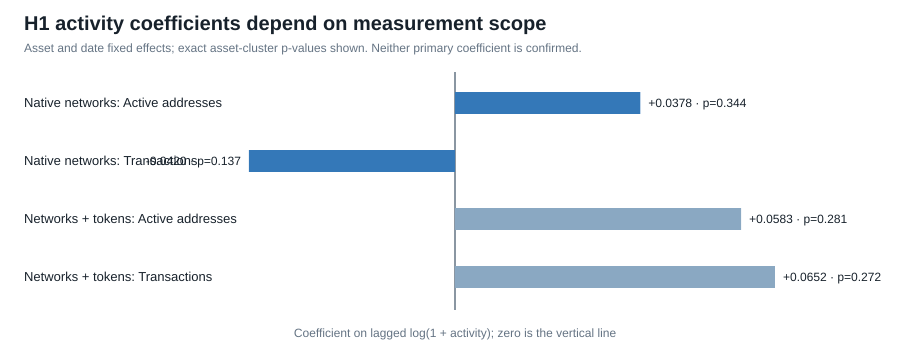

# H1 native-network activity expansion

The H1 expansion was frozen before estimation. Asset selection follows complete Coin Metrics Community coverage rather than observed coefficients: nine native networks form the primary sample, while AAVE, UNI, and LINK token-contract activity is kept in a separate sensitivity. DOGE remains outside the active research universe and XMR lacks the required active-address measure.

## Primary result

The balanced primary panel contains 792 asset-days: nine native networks over 88 common dates. The model uses one-day-lagged log active addresses and log transaction counts to explain log market capitalization, with asset and date fixed effects.

- Active-address coefficient: 0.0378; exact nine-cluster p-value: 0.3438.
- Transaction-count coefficient: -0.0420; exact nine-cluster p-value: 0.1367.
- Within R-squared: 0.0667.
- The transaction coefficient remains negative in all nine leave-one-asset-out estimates.
- The active-address coefficient becomes negative when XLM is omitted.

Neither activity measure is statistically confirmed. The positive active-address result is not sign-stable, and transaction count has the opposite sign from H1.

## Measurement-scope sensitivity

Adding AAVE, UNI, and LINK creates a twelve-asset sample that mixes native-ledger activity with ERC-20 token-contract activity. Both coefficients become positive, but neither is confirmed: active addresses are 0.0583 with p=0.2813, and transactions are 0.0652 with p=0.2725.

This sign change is not stronger support for H1. It demonstrates that “activity” is not one comparable object across cryptoassets. The primary interpretation therefore remains tied to native networks, and the mixed sample is reported only as a sensitivity.

## Current conclusion

H1 remains unconfirmed. Activity may be relevant to valuation, but the result depends on the metric and measurement scope. Active addresses are ledger addresses rather than users, provider transaction definitions differ across networks, and contemporaneous activity and market value can move together without either causing the other.

## Next gate

Collect a longer, fixed common history for the same nine native networks. Do not add token contracts to improve coefficient signs, and do not alter the sample based on the observed results.
