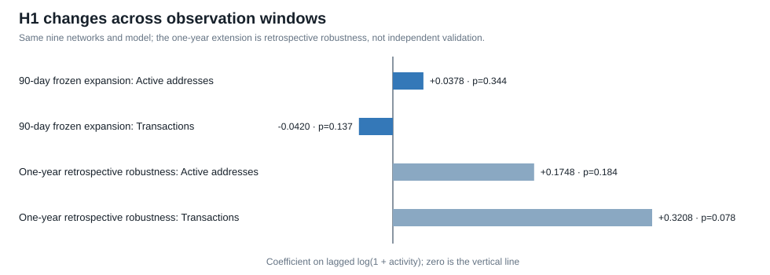

# H1 one-year native-network robustness

The same nine native networks and the same fixed-effects model used in the frozen 90-day H1 expansion were extended backward to a one-year source window. The extension was specified after seeing the 90-day result, so it is retrospective robustness—not independent validation.

## Data and test

- Coin Metrics Community activity coverage: 365/365 days for all nine assets.
- Balanced market-and-activity panel: 3,258 asset-days across 362 common dates, 25 August 2025 through 21 August 2026.
- Predictors: one-day-lagged log active addresses and log transaction count.
- Outcome: log market capitalization.
- Controls: asset and date fixed effects.
- Inference: exhaustive asset-cluster sign enumeration, 512 assignments.

## Result

- Active-address coefficient: 0.1748; exact p-value: 0.1836.
- Transaction-count coefficient: 0.3208; exact p-value: 0.0781.
- Within R-squared: 0.1666.
- Active addresses remain positive in every leave-one-asset-out estimate.
- Transactions are positive in eight of nine leave-one-asset-out estimates, but become -0.0154 when XLM is removed.

## Interpretation

The longer window provides suggestive evidence that greater transaction activity is associated with greater network value. It does not confirm H1. The window was selected after the short-window analysis, transaction definitions differ across networks, activity and valuation are jointly determined, and the transaction result is not sign-stable to excluding XLM.

The correct next step is to preserve the nine-network model and test it on a genuinely later fixed window. The model should not be retuned around the present p-value.
