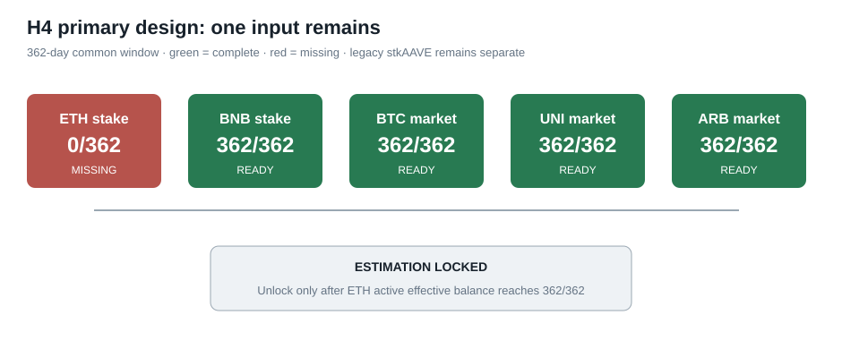

# H4 design freeze and readiness correction — 12 October 2026

H4 asks whether a larger staked share is associated with lower turnover, different volatility, or different drawdown. No H4 coefficient has been estimated.

## Correction before estimation

The earlier catalog required three comparable positive-staking histories, but the fixed universe contains only two comparable consensus-staking systems: ETH and BNB. AAVE absorbs protocol deficit risk and is not consensus stake. Requiring three comparable positive series while refusing to pool AAVE made the gate impossible.

The primary design is now frozen as:

- positive-staking assets: ETH and BNB;
- structural non-staking controls: BTC, UNI, and ARB;
- separate case study: legacy stkAAVE, never pooled with consensus stake;
- common window: 25 August 2025 through 21 August 2026;
- predictor: one-day-lagged staked share of circulating supply;
- outcomes: volume/market-cap turnover, 30-day realized volatility, and drawdown from the 90-day high;
- controls: log market capitalization and BTC return, with asset and date fixed effects;
- interpretation: associational, not causal.

## Current readiness

Market outcomes are complete for all five primary assets. BNB consensus stake is complete. The legacy stkAAVE series is complete for its separate case study. ETH active effective balance remains absent because free public endpoints tested by the project do not provide the required historical validator state. Estimation remains prohibited until ETH covers the common window.

The machine-readable design is `config/crypto_h4_analysis.json`; the generated gate is `data/processed/02_valuation/crypto_h4_analysis_readiness.json`.
