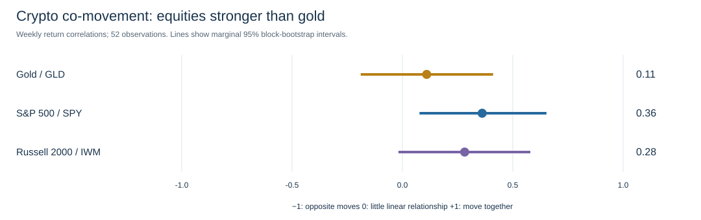
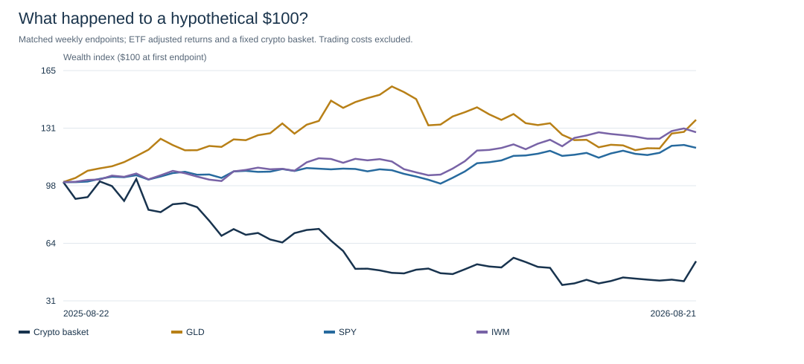
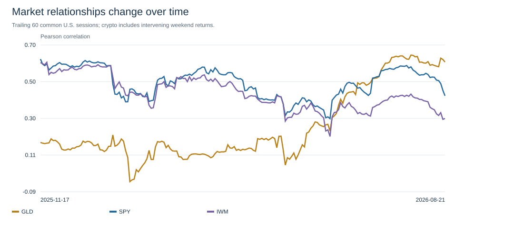
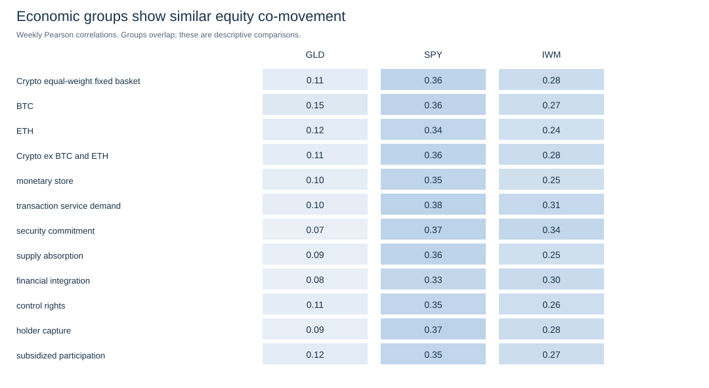

# Digital assets: economic function, valuation and market risk

Independent research discussion draft | 19 October 2026

Prepared for an advisory audience, including the planned Goldman Sachs advisory discussion. This document is independent research and carries no firm endorsement. Historical evidence ends in August 2026; it is not an October market update.

## One-page briefing

### What we built

A verified economic-function matrix for 23 cryptoassets, five hypothesis studies, six exploratory relative-valuation models, and a matched-return benchmark comparison. These layers answer different questions: what a token does, what may support its value, and how its market risk relates to traditional assets.

### Three messages for the meeting

| What we measured | What the evidence says | Advisory use |
|---|---|---|
| Economic design | 230 sourced decisions; same-architecture pairs share 51.7% of functions versus 33.1% across architectures | Select economic peers and metrics using the token’s actual functions |
| Relative value | Eight groups reduce held-out error by 19.1% versus a raw function count; adding capture to the fundamentals model worsens error by 7.8% | Use models to structure questions; investigate large residuals and wide uncertainty bands |
| Portfolio context | Weekly co-movement is strongest with SPY in this sample; crypto loses in 67% of SPY-negative weeks | Assess crypto as a risky allocation; low average correlation alone does not establish protection |

### What can be presented with confidence

The classification instrument is auditable and useful for economic due diligence. The numerical findings are reproducible exploratory estimates. Precision, generalizability and independent validation are different standards: these data do not establish universal valuation multiples, safe-haven status or trading signals.

## 1. Research scope and classification

The ten functions are monetary use, gas, staking, burn, scarcity, collateral, governance, protocol capture, utility and incentives. Architecture records operational context. Assets can have several economic functions; governance over a treasury does not itself establish value reaching the token or holder.

Each decision follows a written rule, dated primary evidence and a recorded adjudication. All 230 cells have evidence, but only ten have an independent blind review. Full-matrix inter-rater reliability has not been established. The industry survey remains a route to external rule validation.

## 2. What the hypotheses currently show

| Question | Result | Interpretation for advisory discussion |
|---|---|---|
| H1: does usage relate to value? | One-year transaction coefficient 0.321; exact p=0.078; sign changes without XLM | Suggestive, sensitive to asset composition |
| H2: does capture strengthen the fee–value relationship? | Broad interaction p=0.082; strict capture p=0.478 | The definition changes the conclusion; fees are not automatically holder income |
| H3: do supply events move prices in the predicted direction? | 8/17 events match; asset-level p=0.25 | No support for a standalone unlock/burn rule; only three independent assets |
| H4: does staking affect liquid float and risk? | ETH archival active-stake data missing | Not yet estimated |
| H8: do groups improve on counting functions? | Best single-group error improvement about 2.8%; separate later validation is frozen | Discovery-sample association; RV1 below is a different model extension |

Earlier function–risk tests yielded no result surviving the declared 10% false-discovery correction. Null and unstable results remain part of the research record.

## 3. Relative valuation: useful comparison, limited precision

RV1 estimates historical geometric mean capitalization with each target asset held out of training and scaling. Ridge regression uses a fixed penalty of 10; no penalty or predictor is selected from these new outcomes. The historical outcomes had already been examined in earlier work, so RV1 remains exploratory.

| Model | Asset count | Held-out log-cap error | What it tests |
|---|---:|---:|---|
| identity_mean | 22 | 2.033 | Same-sample mean benchmark |
| identity_breadth | 22 | 1.816 | Count of ten functions |
| identity_groups | 22 | 1.469 | Eight economic groups jointly |
| fundamentals_mean | 11 | 2.432 | Smaller-sample mean benchmark |
| fundamentals_activity | 11 | 1.347 | Fees, volume and chain/application scope |
| fundamentals_capture | 11 | 1.452 | Adds static verified capture |

Errors are comparable only within identical samples. The identity model substantially underpredicts BTC: observed/model capitalization is about 168x. This is an example of missing economic information and model inadequacy, not proof that BTC is overpriced. Empirical error bands are descriptive and have no calibrated coverage guarantee.

Peer valuation uses shared functions, matched fee scope, a target excluded from its peer set, and at least three eligible peers. Holder-revenue multiples require verified capture. Provider-defined holder revenue is not automatically a legal cash-flow entitlement. Asset estimates and all contributions are preserved in the RV1 CSV.

## 4. Crypto versus gold and U.S. equities

### What is being compared

GLD represents gold, SPY represents the S&P 500, and IWM represents Russell 2000. Vendor-adjusted ETF returns reflect the instruments rather than exact spot-gold or index total returns. Crypto is a retrospective fixed basket of 21 eligible assets, rebalanced equally each calendar day before costs. HYPE has no source history and TON has only 310 of 363 required calendar closes, below the fixed 90% rule. These exclusions follow coverage, not observed correlations.

The primary study has 52 matched weekly returns, from endpoints 22 August 2025 through 21 August 2026. Crypto compounds through weekends between the same ETF endpoints. U.S. holidays are not filled with artificial zero returns. Crypto UTC and ETF New York closing times differ; shifted-close checks quantify sensitivity.

### Main correlations

A correlation near +1 means returns tend to move together; near zero means little linear co-movement. It does not describe whether an asset is cheap, whether both assets made money, or whether losses are protected.

| Benchmark proxy | Weekly Pearson | Rank correlation | 95% block-bootstrap interval | Weeks |
|---|---:|---:|---|---:|
| GLD | 0.11 | 0.09 | -0.19 to 0.41 | 52 |
| SPY | 0.36 | 0.48 | 0.08 to 0.65 | 52 |
| IWM | 0.28 | 0.34 | -0.02 to 0.58 | 52 |

Intervals use 2,000 paired circular moving-block draws in four-week blocks. They are marginal intervals for three declared correlations, not simultaneous familywise intervals or confirmatory significance tests. The gold and small-cap intervals include zero. The one-year sample cannot establish stable multi-cycle relationships. Bootstrap interpretation assumes the chosen period represents sufficiently stable dependence; regime changes weaken that approximation.



### Returns and risk on the same endpoints

| Series | Period return | Annualized weekly volatility | Worst drawdown observed at weekly endpoints |
|---|---:|---:|---:|
| Crypto equal-weight fixed basket | -46.2% | 56.9% | -60.7% |
| BTC | -33.0% | 46.5% | -50.8% |
| ETH | -47.9% | 63.9% | -67.3% |
| Crypto ex BTC and ETH | -47.0% | 57.6% | -61.1% |
| GLD | 36.3% | 23.8% | -23.8% |
| SPY | 20.0% | 12.2% | -8.4% |
| IWM | 29.1% | 15.7% | -8.7% |

Drawdowns sampled weekly can miss deeper intraday or daily losses. Volatility uses weekly standard deviation times √52. No borrowing, staking income, transaction costs or investor taxes are included for crypto; adjusted ETF prices use the vendor’s treatment of distributions. USDT-versus-USD basis risk remains.



### Does the conclusion survive other measurements?

| Measurement | Gold / GLD | S&P 500 / SPY | Russell 2000 / IWM |
|---|---:|---:|---:|
| daily | 0.23 | 0.46 | 0.44 |
| weekly first half | -0.17 | 0.51 | 0.45 |
| weekly second half | 0.46 | 0.27 | 0.15 |
| weekly crypto shift minus1 | 0.04 | 0.23 | 0.05 |
| weekly crypto shift plus1 | 0.18 | 0.35 | 0.32 |

The gold relationship changes sign across chronological halves. Russell 2000 co-movement is sensitive to the timing choice. SPY remains positive in all listed measurements, but its magnitude changes. A single correlation matrix would conceal this instability. The rolling series below is descriptive and contains overlapping windows.



### What happens when equities fall?

| Regime | Series | Weeks | Mean weekly return | Share of weeks with losses |
|---|---|---:|---:|---:|
| SPY negative week | Crypto equal-weight fixed basket | 21 | -3.3% | 67% |
| SPY negative week | GLD | 21 | 0.2% | 38% |
| SPY negative week | SPY | 21 | -1.3% | 100% |
| SPY negative week | IWM | 21 | -0.8% | 71% |
| SPY bottom quintile week | Crypto equal-weight fixed basket | 11 | -2.8% | 73% |
| SPY bottom quintile week | GLD | 11 | -1.6% | 64% |
| SPY bottom quintile week | SPY | 11 | -1.9% | 100% |
| SPY bottom quintile week | IWM | 11 | -1.5% | 82% |

Crypto lost money in two-thirds of the 21 SPY-negative weeks. In the 11 worst-quintile SPY weeks, its average return was also negative. Eleven observations are too few for the declared regime-correlation threshold; those correlations are withheld. These are conditional descriptions, with no proof of safe-haven behavior or a causal stress mechanism.

### Do economic groups behave alike?

Group-basket SPY correlations cluster between 0.33 and 0.38. Economic roles distinguish valuation channels, while this sample shows broadly shared equity co-movement. The observed differences are not evidence of distinct risk factors.



Groups overlap; the same token can appear in several baskets. These results describe the current classification applied retrospectively. Differences cannot establish a causal effect of staking, governance or capture.

## 5. Technical market context

Technical measures describe past trend and price variation. They enter the report as market context; they do not set the economic classifications or valuation model choices. The following table reuses the archived dashboard inputs and is dated at the actual observed close.

| Asset | Last observed close date | Prior 30-day return | Prior 90-day return | 30-day volatility, annualized |
|---|---|---:|---:|---:|
| BTC | 2026-08-22 | 18.4% | 0.0% | 43.0% |
| ETH | 2026-08-22 | 29.0% | 15.4% | 68.5% |
| BNB | 2026-08-22 | 22.5% | 5.9% | 31.9% |
| XRP | 2026-08-22 | 32.0% | 8.2% | 78.5% |
| SOL | 2026-08-22 | 23.6% | 10.0% | 50.3% |
| TRX | 2026-08-22 | 4.7% | -5.9% | 13.3% |
| HYPE | Unavailable | Unavailable | Unavailable | Unavailable |
| ZEC | 2026-08-22 | 58.9% | 21.0% | 109.0% |
| LINK | 2026-08-22 | 37.5% | 23.5% | 68.2% |
| ADA | 2026-08-22 | 34.1% | -6.7% | 77.0% |
| XLM | 2026-08-22 | 7.3% | 32.6% | 64.0% |
| BCH | 2026-08-22 | 30.6% | -20.3% | 95.9% |
| LTC | 2026-08-22 | 11.7% | -0.6% | 48.6% |
| HBAR | 2026-08-22 | 8.9% | -12.4% | 43.1% |
| SUI | 2026-08-22 | 9.4% | -21.2% | 69.3% |
| AVAX | 2026-08-22 | 19.6% | -18.6% | 62.7% |
| TON | 2026-06-30 | -15.6% | 29.3% | 91.0% |
| TAO | 2026-08-22 | 15.3% | -19.1% | 56.0% |
| UNI | 2026-08-22 | 14.4% | 26.9% | 89.6% |
| AAVE | 2026-08-22 | 33.1% | 47.7% | 96.2% |
| ARB | 2026-08-22 | 14.8% | -6.3% | 82.3% |
| OP | 2026-08-22 | 17.7% | -13.2% | 74.5% |
| POL | 2026-08-22 | 40.4% | 18.7% | 75.3% |

These existing dashboard momentum labels use counts of daily observations; gaps can change their calendar meaning. The new cross-asset analysis independently requires every intervening calendar return and does not use these indicators as predictors.

## 6. Advisory application and open work

Use the work in this order: identify the token’s economic functions; select comparable assets and relevant fundamentals; inspect the model’s error and precision; then assess traditional-asset co-movement, stress behavior and market risk. Final portfolio judgment requires client-specific objectives and exposure constraints beyond this research.

| Finding | Decision supported | What must happen before a stronger claim |
|---|---|---|
| Economic groups improve some held-out comparisons | Organize peer selection by function | External rule feedback and later samples |
| Fees alone do not establish holder value | Trace the actual capture mechanism | Better time-varying capture and distribution measurement |
| BTC is poorly explained by the function model | Treat residuals as due-diligence questions | Monetary adoption, network and liquidity fundamentals |
| Correlations change with sample and clock | Use ranges and stress context | Longer history and synchronized intraday closes |
| H4 remains blocked | Keep staking-liquidity conclusions open | Archive-capable ETH consensus data |

Immediate follow-up is methodological review of the draft, external survey feedback, a longer benchmark history with a separately frozen window, and independent verification of critical market prices. Do not retune the current results to improve the presentation.

## Appendix A. Economic classification and peer context

| Asset | Architecture | Verified economic roles | Closest economic comparables |
|---|---|---|
| BTC | PoW | money or store-of-value use; collateral and financial integration | ETH, LTC, BCH |
| ETH | PoS | money or store-of-value use; transaction and service demand; staked security commitment; supply reduction or absorption; collateral and financial integration; direct holder or token capture | AVAX, BNB, SOL |
| BNB | PoS family | money or store-of-value use; transaction and service demand; staked security commitment; supply reduction or absorption; collateral and financial integration; governance and control rights; direct holder or token capture; subsidized participation | HYPE, TRX, ETH |
| XRP | federated consensus | money or store-of-value use; transaction and service demand; supply reduction or absorption; direct holder or token capture; subsidized participation | HYPE, TRX, AVAX |
| SOL | PoS family | transaction and service demand; staked security commitment; supply reduction or absorption; collateral and financial integration; direct holder or token capture; subsidized participation | BNB, ETH, HYPE |
| TRX | DPoS | money or store-of-value use; transaction and service demand; staked security commitment; supply reduction or absorption; governance and control rights; direct holder or token capture; subsidized participation | HYPE, BNB, ADA |
| HYPE | PoS family | money or store-of-value use; transaction and service demand; staked security commitment; supply reduction or absorption; governance and control rights; direct holder or token capture; subsidized participation | TRX, BNB, ADA |
| ZEC | PoW | money or store-of-value use; governance and control rights; subsidized participation | ARB, LTC, ADA |
| LINK | service staking | money or store-of-value use; transaction and service demand; staked security commitment; direct holder or token capture; subsidized participation | HYPE, TRX, ADA |
| ADA | PoS | money or store-of-value use; transaction and service demand; staked security commitment; governance and control rights; subsidized participation | SUI, HYPE, TRX |
| XLM | federated consensus | money or store-of-value use; transaction and service demand; subsidized participation | BCH, LTC, ADA |
| BCH | PoW | money or store-of-value use; transaction and service demand; subsidized participation | XLM, LTC, ADA |
| LTC | PoW | money or store-of-value use; subsidized participation | BCH, XLM, ZEC |
| HBAR | hashgraph PoS | money or store-of-value use; transaction and service demand; staked security commitment | TAO, SUI, POL |
| SUI | PoS | money or store-of-value use; transaction and service demand; staked security commitment; governance and control rights | ADA, HBAR, TAO |
| AVAX | PoS | money or store-of-value use; transaction and service demand; staked security commitment; supply reduction or absorption; direct holder or token capture | ETH, HYPE, TRX |
| TON | PoS | transaction and service demand; staked security commitment; supply reduction or absorption; governance and control rights; direct holder or token capture | HYPE, TRX, AVAX |
| TAO | PoS family | money or store-of-value use; transaction and service demand; staked security commitment | HBAR, SUI, POL |
| UNI | NA | supply reduction or absorption; governance and control rights; direct holder or token capture | TON, OP, HYPE |
| AAVE | NA | staked security commitment; collateral and financial integration; governance and control rights; subsidized participation | ADA, ARB, BNB |
| ARB | rollup | governance and control rights; subsidized participation | OP, ZEC, AAVE |
| OP | rollup | governance and control rights; direct holder or token capture; subsidized participation | ARB, UNI, ZEC |
| POL | PoS | transaction and service demand; staked security commitment | HBAR, TAO, SUI |

## Appendix B. Reproducibility and limitations

CA1 was specified and committed before its estimates. Benchmark payloads are archived unchanged with SHA-256 checksums and retrieval timestamps. The normalized data rebuild without credentials. Weekly return tables, all asset/group correlations, sensitivity results and rolling series are retained in `data/processed/03_risk/`. RV1 estimates and coefficients’ contributions are in `data/processed/02_valuation/`.

Sources are public and auditable, but critical market figures have not yet been verified against an independent second vendor. Current-universe selection creates survivorship bias. Equal weighting emphasizes smaller assets and daily rebalancing is hypothetical. Historical USDT prices are approximate USD measures. Contemporary function codes are not historical point-in-time signals. Correlation coefficients do not identify causal exposures, formal multi-factor loadings or diversification during every stress event. Single-coder classifications, overlapping groups, small cross-sections, a single market year and data-provider definitions constrain inference.

### Source and instrument references

GLD follows gold bullion less expenses; SPY seeks S&P 500 price and yield exposure; IWM seeks Russell 2000 exposure. ETF adjusted closes are obtained from the archived vendor responses, not from the issuer product pages.

- [GLD official instrument description](https://www.ssga.com/us/en/individual/etfs/spdr-gold-shares-gld). Snapshot retrieved 2026-10-19T17:49:54.354196+00:00; SHA-256 `528a80562812bcd32c052843005b04cd5e231ebfafa0889043db17235a2c06da`.

- [SPY official instrument description](https://www.ssga.com/us/en/individual/etfs/spdr-sp-500-etf-trust-spy). Snapshot retrieved 2026-10-19T17:49:54.549979+00:00; SHA-256 `761de3a8804536205b480dd18e3c0c9b9932783b2fca881cbb7581402cc7312e`.

- [IWM official instrument description](https://www.ishares.com/us/products/239710/iwm-ishares-russell-2000-etf). Snapshot retrieved 2026-10-19T17:49:54.673405+00:00; SHA-256 `5f5219ef8541b52bc8f353726c8425ef728e1abcc78433d9d6fb0b5c1cc4eb97`.

### Rebuild commands

```bash
python -m src.pipeline.cross_asset_market_data --repo . --offline
python -m src.pipeline.crypto_cross_asset --repo .
python -m src.pipeline.crypto_advisory_report --repo .
```
