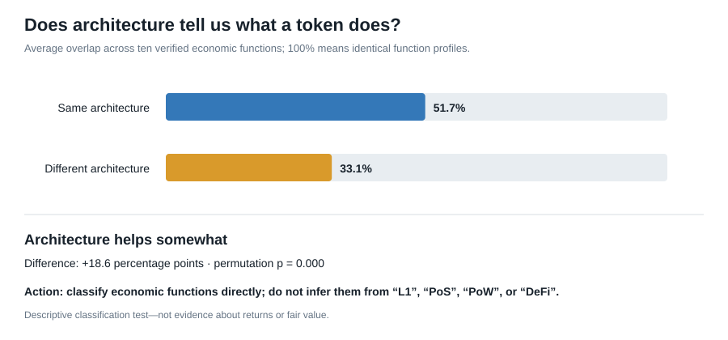

# Does technical architecture identify economic function?

Across 23 assets there are 253 unique pairs. Same-architecture pairs have average economic-function similarity of 51.7%; cross-architecture pairs average 33.1%. Same-architecture similarity is 18.6% higher, with a label-permutation p-value of 0.000.

## Strongest cross-architecture economic peers

| Pair | Architecture | Function similarity |
|---|---|---:|
| HBAR–TAO | hashgraph PoS vs PoS family | 100% |
| BNB–TRX | PoS family vs DPoS | 89% |
| BCH–XLM | PoW vs federated consensus | 80% |
| HBAR–SUI | hashgraph PoS vs PoS | 80% |
| SUI–TAO | PoS vs PoS family | 80% |
| BNB–ETH | PoS family vs PoS | 78% |
| HYPE–TRX | PoS family vs DPoS | 78% |
| AVAX–HYPE | PoS vs PoS family | 75% |
| ETH–SOL | PoS vs PoS family | 75% |
| HBAR–POL | hashgraph PoS vs PoS | 75% |

## Advisory meaning

Architecture is useful operational context, but economic functions must be measured directly. Assets built differently may perform nearly identical economic jobs, while assets sharing an architecture may have materially different value routes. Comparable selection should therefore begin with economic-function overlap and use architecture as a secondary risk descriptor.
