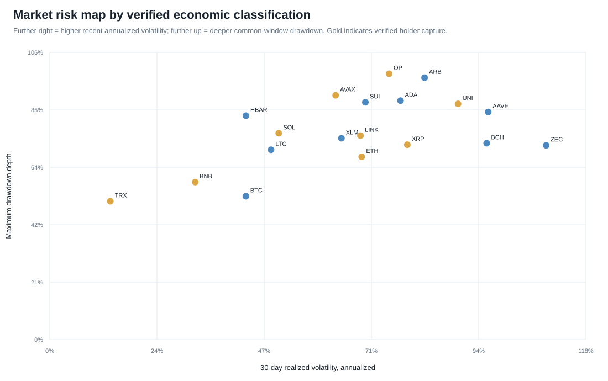

# Classification-informed market and valuation dashboard

Frozen 2026-10-19; market data end 2026-08-22. This dashboard describes market state and selects valuation metrics using the verified economic-function matrix. It does not issue recommendations, price targets, rankings, or investment scores.

## Coverage

- Economic classifications: 23 assets.
- Technical market history: 22 assets.
- Common-window risk measures: 19 assets.
- Market-cap observations in the valuation panel: 11 assets.
- Measurable holder-revenue multiples: 7 assets.

## Asset dashboard

| Asset | Economic lens | 30d | 90d | Volatility | Beta | Drawdown | Valuation status |
|---|---|---:|---:|---:|---:|---:|---|
| BTC | monetary_store, financial_integration | 18.4% | 0.0% | 43.0% | 0.60 | -53.0% | market_cap |
| ETH | monetary_store, transaction_service_demand, security_commitment, supply_absorption, financial_integration, holder_capture | 29.0% | 15.4% | 68.5% | 0.89 | -67.6% | market_cap, fees, holder_revenue |
| BNB | monetary_store, transaction_service_demand, security_commitment, supply_absorption, financial_integration, control_rights, holder_capture, subsidized_participation | 22.5% | 5.9% | 31.9% | 0.59 | -58.2% | market_cap, fees, holder_revenue |
| XRP | monetary_store, transaction_service_demand, supply_absorption, holder_capture, subsidized_participation | 32.0% | 8.2% | 78.5% | 0.96 | -72.0% | market_cap, fees, holder_revenue |
| SOL | transaction_service_demand, security_commitment, supply_absorption, financial_integration, holder_capture, subsidized_participation | 23.6% | 10.0% | 50.3% | 1.06 | -76.3% | market_cap, fees, holder_revenue |
| TRX | monetary_store, transaction_service_demand, security_commitment, supply_absorption, control_rights, holder_capture, subsidized_participation | 4.7% | -5.9% | 13.3% | 0.35 | -51.1% | market_cap, fees, holder_revenue |
| HYPE | monetary_store, transaction_service_demand, security_commitment, supply_absorption, control_rights, holder_capture, subsidized_participation | — | — | — | — | — | unavailable |
| ZEC | monetary_store, control_rights, subsidized_participation | 58.9% | 21.0% | 109.0% | 1.05 | -71.8% | unavailable |
| LINK | monetary_store, transaction_service_demand, security_commitment, holder_capture, subsidized_participation | 37.5% | 23.5% | 68.2% | 1.15 | -75.4% | unavailable |
| ADA | monetary_store, transaction_service_demand, security_commitment, control_rights, subsidized_participation | 34.1% | -6.7% | 77.0% | 1.16 | -88.3% | market_cap, fees |
| XLM | monetary_store, transaction_service_demand, subsidized_participation | 7.3% | 32.6% | 64.0% | 0.98 | -74.4% | unavailable |
| BCH | monetary_store, transaction_service_demand, subsidized_participation | 30.6% | -20.3% | 95.9% | 0.89 | -72.6% | unavailable |
| LTC | monetary_store, subsidized_participation | 11.7% | -0.6% | 48.6% | 0.89 | -70.1% | unavailable |
| HBAR | monetary_store, transaction_service_demand, security_commitment | 8.9% | -12.4% | 43.1% | 1.10 | -82.7% | unavailable |
| SUI | monetary_store, transaction_service_demand, security_commitment, control_rights | 9.4% | -21.2% | 69.3% | 1.22 | -87.7% | unavailable |
| AVAX | monetary_store, transaction_service_demand, security_commitment, supply_absorption, holder_capture | 19.6% | -18.6% | 62.7% | 1.17 | -90.3% | market_cap, fees, holder_revenue |
| TON | transaction_service_demand, security_commitment, supply_absorption, control_rights, holder_capture | -15.6% | 29.3% | 91.0% | — | — | unavailable |
| TAO | monetary_store, transaction_service_demand, security_commitment | 15.3% | -19.1% | 56.0% | — | — | unavailable |
| UNI | supply_absorption, control_rights, holder_capture | 14.4% | 26.9% | 89.6% | 1.20 | -87.1% | market_cap, fees, holder_revenue |
| AAVE | security_commitment, financial_integration, control_rights, subsidized_participation | 33.1% | 47.7% | 96.2% | 1.15 | -84.1% | market_cap |
| ARB | control_rights, subsidized_participation | 14.8% | -6.3% | 82.3% | 1.28 | -96.8% | market_cap |
| OP | control_rights, holder_capture, subsidized_participation | 17.7% | -13.2% | 74.5% | 1.29 | -98.3% | unavailable |
| POL | transaction_service_demand, security_commitment | 40.4% | 18.7% | 75.3% | — | — | unavailable |

## How to use it

1. Select peers from shared economic functions, not architecture alone.
2. Read momentum, volatility, beta and drawdown as market-state and risk context—not intrinsic value.
3. Use only function-relevant valuation denominators. A fee multiple is not evidence of holder value capture.
4. Treat `data_unavailable` as a research gap and `not_applicable` as an economic judgment; neither means zero.
5. Investigate price–fundamental divergence, then complete custody, liquidity, legal, concentration and suitability review separately.
