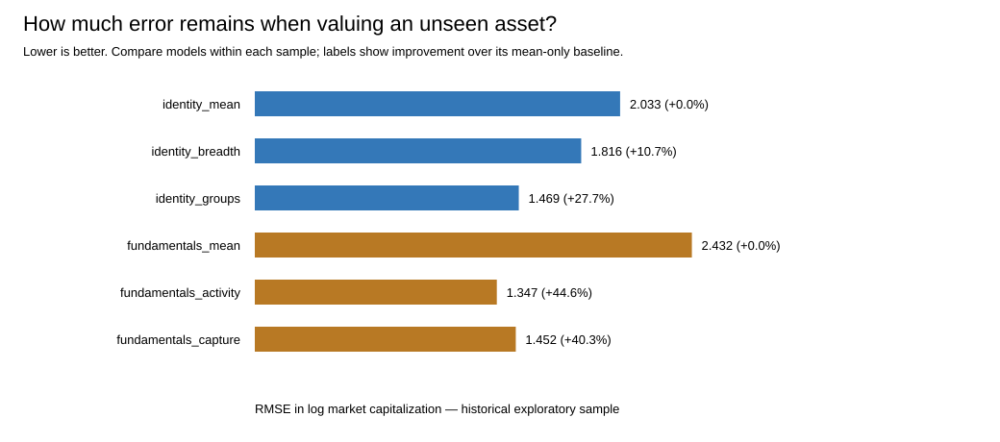

# Relative valuation: findings and asset models

New exploratory models on previously examined historical outcomes; not preregistered confirmation or temporal validation.

The outcome is geometric mean market capitalization over the historical window. Each asset is excluded from its own model fit. Static classifications are retrospective descriptors; the result does not estimate a current price target.

## What we tested

Do economic functions improve prediction of relative network size, and does holder capture add information beyond fees, volume and fee scope? Fixed-penalty ridge regression limits model flexibility in these small samples.

## What we found

| Model | Assets | Held-out RMSE (log cap) | Improvement vs same-sample mean |
|---|---:|---:|---:|
| identity_mean | 22 | 2.033 | 0.0% |
| identity_breadth | 22 | 1.816 | 10.7% |
| identity_groups | 22 | 1.469 | 27.7% |
| fundamentals_mean | 11 | 2.432 | 0.0% |
| fundamentals_activity | 11 | 1.347 | 44.6% |
| fundamentals_capture | 11 | 1.452 | 40.3% |

Economic groups reduce held-out error by 19.1% relative to raw function count. Adding the static capture flag changes fundamentals-model error by +7.8% (positive means worse). These are new exploratory model comparisons; they do not replace H2 or H8.

The largest identity-model error is BTC: observed/model = 168.3x. This shows that function labels alone leave major asset-specific value unexplained. Treat this as model failure to explain the asset, rather than an investment opportunity.

Positive improvement means smaller held-out errors. Compare models within the same sample. These comparisons have no confirmatory p-values. All models are reported; no selected winner is deployed.

## Asset estimates

The table reports every asset under the identity-group model. Ratios above 1 mean observed historical size exceeds the held-out estimate. Error bands use inner held-out errors and have no calibrated coverage guarantee. Large bands signal weak valuation precision.

| Asset | Observed mean cap ($bn) | Model-implied cap ($bn) | Observed/model | Empirical band ($bn) |
|---|---:|---:|---:|---|
| BTC | 1626.03 | 9.66 | 168.33x | 1.79–52.00 |
| ETH | 309.64 | 125.04 | 2.48x | 18.44–848.11 |
| BNB | 103.51 | 95.13 | 1.09x | 14.62–618.85 |
| XRP | 101.57 | 19.79 | 5.13x | 3.22–121.74 |
| SOL | 62.57 | 22.82 | 2.74x | 3.91–133.22 |
| TRX | 27.27 | 10.03 | 2.72x | 1.67–60.44 |
| HYPE | 13.35 | 11.95 | 1.12x | 1.85–77.11 |
| ZEC | 4.97 | 5.63 | 0.88x | 0.90–35.05 |
| LINK | 7.32 | 8.60 | 0.85x | 1.33–55.54 |
| ADA | 12.61 | 3.41 | 3.70x | 0.52–22.23 |
| XLM | 7.04 | 11.99 | 0.59x | 1.94–74.11 |
| BCH | 8.37 | 11.47 | 0.73x | 1.85–71.23 |
| LTC | 4.97 | 9.92 | 0.50x | 1.57–62.71 |
| HBAR | 4.79 | 8.02 | 0.60x | 1.23–52.32 |
| SUI | 4.95 | 4.72 | 1.05x | 0.75–29.78 |
| AVAX | 4.85 | 30.28 | 0.16x | 6.37–143.98 |
| TAO | 2.50 | 9.18 | 0.27x | 1.49–56.38 |
| UNI | 2.75 | 4.73 | 0.58x | 0.62–35.94 |
| AAVE | 2.04 | 12.45 | 0.16x | 1.58–98.00 |
| ARB | 0.92 | 1.38 | 0.67x | 0.20–9.32 |
| OP | 0.42 | 2.77 | 0.15x | 0.46–16.65 |
| POL | 1.04 | 2.03 | 0.51x | 0.30–13.51 |

## Fundamentals model estimates

| Asset | Observed mean cap ($bn) | Activity model cap ($bn) | Observed/model | Largest centered predictor contribution (log units) |
|---|---:|---:|---:|---|
| BTC | 1626.03 | 149.47 | 10.88x | log_mean_daily_volume: +2.05 |
| ETH | 309.64 | 81.98 | 3.78x | log_mean_daily_volume: +1.69 |
| BNB | 103.51 | 24.41 | 4.24x | application_scope: +0.14 |
| XRP | 101.57 | 51.00 | 1.99x | log_mean_daily_volume: +0.47 |
| SOL | 62.57 | 43.99 | 1.42x | log_mean_daily_volume: +0.75 |
| TRX | 27.27 | 23.84 | 1.14x | log_mean_daily_volume: -0.28 |
| ADA | 12.61 | 28.02 | 0.45x | log_mean_daily_volume: -0.43 |
| AVAX | 4.85 | 17.76 | 0.27x | log_mean_daily_volume: -0.73 |
| UNI | 2.75 | 3.90 | 0.71x | log_mean_daily_volume: -1.17 |
| AAVE | 2.04 | 6.19 | 0.33x | log_mean_daily_volume: -0.95 |
| ARB | 0.92 | 10.94 | 0.08x | log_mean_daily_volume: -1.35 |

Contributions add to the training intercept to reconstruct the predicted log capitalization. They describe the fitted model, not causal economic effects. Full contributions and error bands for every model are included in the asset CSV.

## Sample coverage

| Asset | Market-cap days | Fee days | Identity eligible | Fundamentals eligible |
|---|---:|---:|---:|---:|
| BTC | 362 | 361 | 1 | 1 |
| ETH | 362 | 361 | 1 | 1 |
| BNB | 362 | 361 | 1 | 1 |
| XRP | 362 | 361 | 1 | 1 |
| SOL | 362 | 361 | 1 | 1 |
| TRX | 362 | 361 | 1 | 1 |
| HYPE | 362 | 0 | 1 | 0 |
| ZEC | 362 | 0 | 1 | 0 |
| LINK | 362 | 0 | 1 | 0 |
| ADA | 362 | 361 | 1 | 1 |
| XLM | 362 | 0 | 1 | 0 |
| BCH | 362 | 0 | 1 | 0 |
| LTC | 362 | 0 | 1 | 0 |
| HBAR | 362 | 0 | 1 | 0 |
| SUI | 362 | 0 | 1 | 0 |
| AVAX | 362 | 361 | 1 | 1 |
| TON | 0 | 0 | 0 | 0 |
| TAO | 362 | 0 | 1 | 0 |
| UNI | 362 | 361 | 1 | 1 |
| AAVE | 362 | 361 | 1 | 1 |
| ARB | 363 | 361 | 1 | 1 |
| OP | 362 | 0 | 1 | 0 |
| POL | 362 | 0 | 1 | 0 |

## Peer multiples

Peers exclude the target, require Jaccard economic-group similarity of at least 0.5, identical fee scope, and at least three eligible peers. Holder-revenue multiples also require verified capture in target and peers. The denominators retain provider definitions and are not automatically distributable cash flows.

| Asset | Metric | State | Eligible peers | Own multiple | Peer median |
|---|---|---|---|---:|---:|
| BTC | fees | not_applicable | — | — | — |
| BTC | holder_revenue | not_applicable | — | — | — |
| ETH | fees | measured | AVAX|BNB|SOL|TRX|XRP | 67.1x | 177.8x |
| ETH | holder_revenue | measured | AVAX|BNB|SOL|TRX|XRP | 1129.7x | 2087.6x |
| BNB | fees | measured | ADA|AVAX|ETH|SOL|TRX|XRP | 177.8x | 155.4x |
| BNB | holder_revenue | measured | AVAX|ETH|SOL|TRX|XRP | 2087.6x | 1129.7x |
| XRP | fees | measured | AVAX|BNB|ETH|SOL|TRX | 28656.5x | 67.1x |
| XRP | holder_revenue | measured | AVAX|BNB|ETH|SOL|TRX | 22125521.8x | 1129.7x |
| SOL | fees | measured | AVAX|BNB|ETH|TRX|XRP | 17.5x | 177.8x |
| SOL | holder_revenue | measured | AVAX|BNB|ETH|TRX|XRP | 138.9x | 2087.6x |
| TRX | fees | measured | ADA|AVAX|BNB|ETH|SOL|XRP | 359.9x | 109.2x |
| TRX | holder_revenue | measured | AVAX|BNB|ETH|SOL|XRP | 48123.5x | 1129.7x |
| HYPE | fees | target_data_unavailable | — | — | — |
| HYPE | holder_revenue | target_data_unavailable | — | — | — |
| ZEC | fees | not_applicable | — | — | — |
| ZEC | holder_revenue | not_applicable | — | — | — |
| LINK | fees | target_data_unavailable | — | — | — |
| LINK | holder_revenue | target_data_unavailable | — | — | — |
| ADA | fees | insufficient_peers | BNB|TRX | 2656.0x | — |
| ADA | holder_revenue | not_applicable | BNB|TRX | — | — |
| XLM | fees | target_data_unavailable | — | — | — |
| XLM | holder_revenue | not_applicable | — | — | — |
| BCH | fees | target_data_unavailable | — | — | — |
| BCH | holder_revenue | not_applicable | — | — | — |
| LTC | fees | not_applicable | — | — | — |
| LTC | holder_revenue | not_applicable | — | — | — |
| HBAR | fees | target_data_unavailable | — | — | — |
| HBAR | holder_revenue | not_applicable | — | — | — |
| SUI | fees | target_data_unavailable | — | — | — |
| SUI | holder_revenue | not_applicable | — | — | — |
| AVAX | fees | measured | BNB|ETH|SOL|TRX|XRP | 38.4x | 177.8x |
| AVAX | holder_revenue | measured | BNB|ETH|SOL|TRX|XRP | 246.4x | 2087.6x |
| TAO | fees | target_data_unavailable | — | — | — |
| TAO | holder_revenue | not_applicable | — | — | — |
| UNI | fees | insufficient_peers | — | 3.9x | — |
| UNI | holder_revenue | target_data_unavailable | — | — | — |
| AAVE | fees | not_applicable | — | — | — |
| AAVE | holder_revenue | not_applicable | — | — | — |
| ARB | fees | not_applicable | — | — | — |
| ARB | holder_revenue | not_applicable | — | — | — |
| OP | fees | target_data_unavailable | — | — | — |
| OP | holder_revenue | target_data_unavailable | — | — | — |
| POL | fees | target_data_unavailable | — | — | — |
| POL | holder_revenue | not_applicable | — | — | — |

## What action follows

Use residuals to identify assets needing closer explanation: adoption, liquidity, supply, data definitions and capture can account for deviations. Use wide bands and insufficient peers as evidence that precise valuation is not supported. Preserve the existing H1–H4/H8 results and obtain later data for independent validation.

## Limitations

The outcomes were previously examined; current classifications summarize historical assets retrospectively. Asset observations are dependent, fee scopes differ, volume may reflect speculation and provider coverage is uneven. Shrinkage biases coefficients by design. The empirical error bands are descriptive; they do not establish fair value, mispricing or a return forecast.
